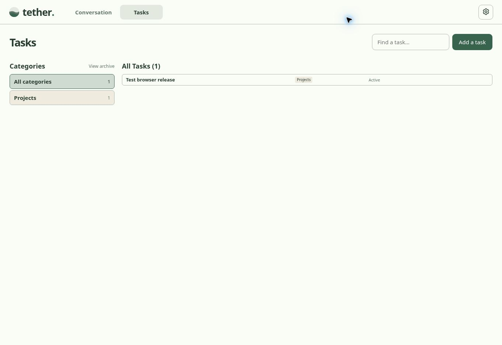

# Browser edition

Open <https://briday1.github.io/tether-chat/>. No Python, desktop process, or tether backend is required. GitHub Pages serves static files; task operations run on your device, and AI requests go directly to the provider you configure.



## Phone installation

On iPhone, open the app in Safari and use **Share → Add to Home Screen**. Other supported browsers offer **Install app** in their browser menu. The app caches its interface after the first online visit, so tasks, notes, activity, deterministic slash commands, and calendars remain available offline. AI chat requires internet.

## AI connection

Use an HTTPS OpenAI-compatible chat-completions endpoint with tool calling. The provider must permit the app's origin through CORS, including the Authorization and Content-Type headers. A provider that works with the desktop Python client may reject browser requests. Test the connection in Settings. The browser edition includes no proxy, and never sends your key to GitHub or a tether backend.

By default a key stays in session storage for this browser session. Optionally save it encrypted with a passphrase of at least eight characters. Persistent storage contains only a PBKDF2-derived AES-GCM ciphertext, salt, and nonce. The unlock passphrase is not saved. Locking removes the session key. Forgetting removes both saved and session keys. Changing the provider URL clears the unlocked key unless you explicitly supply a key for the new URL. Like any web app, scripts running in the app's origin can access an unlocked session; the browser is not an operating-system credential vault.

AI requests use a short recent conversation window and retrieve task context through tools. The tool declarations and system prompt are extracted from the desktop source during the build. Identical tool calls are not executed twice. Task operations commit to IndexedDB before the model is told they succeeded.

## Local data and backups

Tasks, entries, action notes, activity, relations, chat history, and jobs use a database scoped to the app's deployment path. IndexedDB transactions prevent simultaneous tab edits from overwriting unrelated changes. **Protect local storage** asks the browser to retain the database; browser settings and clearing website data can still remove it.

Use **Settings → Download backup** regularly. Portable JSON backups include all task data and conversations, but no provider settings, API keys, or queued jobs. **Import backup** validates the full file and merges new records in one transaction. Identical IDs are accepted once; conflicting versions or broken references reject the entire import and retain current data. To preserve two conflicting versions, import the other backup into a separate empty browser profile. The import UI accepts files up to 20 MB.

To copy existing desktop data into the browser, update the desktop package and run:

```sh
tether-chat export --output tether-portable-backup.json
```

The command creates a new file and refuses to overwrite an existing file. Import it using the browser's Settings. A running desktop server also provides a portable download at `/api/portable`; its normal SQLite backup at `/api/backup` remains available. Browser JSON files are browser-importable backups, not replacements for desktop SQLite databases. Automatic desktop/phone sync is not included.

## Requests and reminders

One persistent parent page owns the AI queue while Conversation and Tasks use the shared desktop screens. Switching screens does not cancel requests. Requests have durable IDs and are serialized across tabs using Web Locks. Closing or reloading the entire app interrupts a running request; tether marks it interrupted and never automatically repeats potentially mutating tool calls. Queued requests can resume. Review any saved changes before explicitly retrying.

Due items appear in Attention. Clicking an item asks a read-only question about that task or selected action. **Reconsider what deserves attention** explicitly asks the model to curate additional task choices; routine background refreshes never spend AI tokens. Optional notifications work while the app remains open. Closed-app push reminders and always-running background AI require a separate service and are not part of this release. The local MCP server, desktop tray, and database folder controls remain desktop features.

## Releases

The existing `publish-pypi.yml` continues producing the desktop wheel and source archive, including Windows/macOS/Linux validation. `web-pages.yml` is a second, independent workflow: it tests the browser engine, runs real browser checks with a synthetic provider, builds static files, uploads the artifact, and deploys Pages. Both use the version in `pyproject.toml`.

For initial repository setup, GitHub Pages must use **GitHub Actions** as its publishing source. The workflow attempts to enable Pages automatically. If the repository token lacks permission to enable Pages, set **Settings → Pages → Source → GitHub Actions**, then rerun **Browser app and GitHub Pages**. No API keys belong in the workflow or static output.

Service-worker caches contain only bundled public application assets. Provider requests, API keys, and task data are never cached as HTTP responses. A new release waits until older app sessions close before activating, keeping active sessions on a consistent set of files. Close all tether browser windows and reopen to pick up an installed update.

## Build and check

```sh
python -m pip install Pillow pytest
python scripts/build_web.py --base-path /tether-chat/
node --test tests/web/*.test.mjs
python -m pytest -q tests/test_browser_build.py
```

The generated `web-dist/` is the Pages artifact; it is not the desktop package or a second copy of the source screens. Local root hosting can use `--base-path /`. Serve the output over HTTPS or localhost; Web Crypto, Web Locks, service workers, and installation require a secure browser context.

On a normal development machine or hosted CI runner, install Playwright and Chromium and run `python scripts/check_web_ui.py`. This checks the real static build at a repository subpath, IndexedDB, desktop imports, scoped action notes, encrypted keys, navigation during AI calls, exports, mobile layout, and fresh offline loads with a synthetic provider. No real API key or user task database is used.
